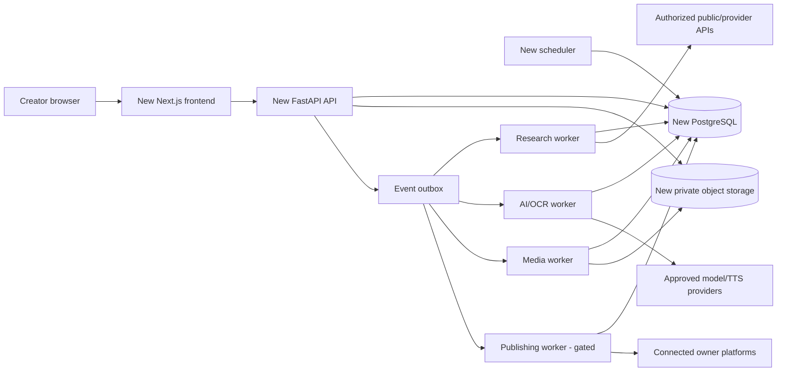

# FLAMINGO NEXT STUDIO
## Complete product and implementation engineering blueprint

**Specification ID:** FNS-BP-001 · **Version:** 1.0 · **Date:** 2026-10-28 · **Owner:** Independent Flamingo creator operation · **Status:** Ready for phased engineering, not a claim of implemented or pre-validated capabilities.

> **INDEPENDENCE CONTRACT — HARD REQUIREMENT**  
> This is a brand-new implementation, **not** a branch, upgrade, clone, fork, database migration, or deployment of `qwazi12/manhwa`. Create a new repository named provisionally `flamingo-next-studio`, new cloud projects and environments, new database, new object-storage buckets, new authentication and provider app registrations, new secrets, new queues, new release pipeline, new subdomain, new logs and new backups. No code, secret, artifact or production state from the existing system is implicitly trusted or reused. The old app remains unaffected. **Do not access or mutate the old system in order to implement this design.** Any one-time optional migration is a future standalone approved project with export ownership checks and dry-run evidence. No existing `main` push/deploy is authorized here.

**Document contract:** This document specifies the intended product, components, interfaces, rules, data ownership, risk boundaries, work sequence and objective acceptance criteria. Supporting files in this package provide executable-leaning reference contracts: schema SQL, OpenAPI, JSON Schema, workflow configuration, prompt pack, test matrix, deployment plan and code-agent instructions. Examples are reference designs that must be validated by CI and integration tests before they become software. They do not guarantee permission to use copyrighted source art or access third-party APIs.

---

# 1. Executive product definition

## 1.1 Product mission

Build a **private AI-first manhwa recap production operating system** that continuously finds evidence-backed content opportunities, understands individual source chapters, builds an accurate persistent story world, plans and produces distinctive recap episodes, verifies their actual delivered media, proposes truthful high-performing packaging, publishes only owner-approved assets, and uses observed results to improve future programming.

**Primary outcome:** more approved, compelling, accurate videos per unit of creator time **without** increasing duplicate work, unsupported narration, intellectual-property risk, platform violations or editing debt.

## 1.2 Product philosophy

- **A manhwa is a series; a chapter is an episode; a multi-chapter video is a compilation.** Source edition and adaptation are tracked separately.
- **One knowledge spine:** one resolved series identity, one approved canon ledger, versioned episode evidence, and content-addressed production artifacts. Models are clients of this information, not independent authorities.
- **Creator-directed:** the owner decides programming, exceptional editorial questions, rights basis, account connections, budgets, publication and public-facing changes. Safe background work can be autonomous within limits.
- **Evidence-first:** every factual story claim has source support; every market signal has provenance, age and quality; every quality verdict says what was actually inspected.
- **Reversible:** corrections create revisions, not silent destructive overwrites. Unaffected media must remain reusable.
- **No autopilot surprises:** no duplicate production, no accidental Drive/upload actions, no silent metadata overwrite, no unapproved paid requests, no production changes during testing.

## 1.3 Intended user and output

Primary user: one creator / owner, optionally a small number of individually invited editors later. English narrated YouTube recaps first; mobile monitoring + desktop production. The software is private, not a public content-rehosting website or multi-tenant SaaS. Default output: original English commentary/narration over authorized source imagery and creator-generated audiovisual presentation. Support separate originals for Shorts, Reels, community posts later. Publishing rights are a per-asset decision, not inferred from the ability to download a chapter.

## 1.4 Explicit non-goals

- No uncontrolled scraping of copyrighted WEBTOON/Asura pages, paywalls, anti-bot evasion, DRM circumvention, account borrowing, or assumption that all accessible images can be republished.
- No guarantee of 9/10 creative work, 10/10 SEO, revenue, fair use or viral growth. These are measurable goals subject to actual evaluation, audience behavior and rights.
- No autonomous channel/account reconnection, license decisions, publication or comment posting.
- No scraping of private YouTube Studio data or competitor account analytics; only authorized owner analytics and permitted public data.
- No auto-generating dozens of channels or operating as a generic public SaaS in v1.
- No dependence on the existing `manhwa` project or its runtime, state or repository.

## 1.5 Default quality targets (provisional pilot thresholds)

Targets are acceptance policy for the new project, **not claims of current performance**. Calibrate against reviewed real outputs.

| Dimension | Minimum pilot exit gate | Mature objective |
|---|---|---|
| Source/order | All authorized source pages accounted for; zero silently omitted pages | Reconstruct reading order with documented exceptions |
| Critical events | 100% of human-labeled must-retain events represented or explicitly waived | 98%+ agreement on full labeled event inventory, per genre |
| Material fabricated facts | Zero known unresolved critical fabrications | Less than 1 confirmed material unsupported claim per 10 reviewed episodes |
| Dialogue | Zero missing critical exchanges in reviewed gold set | 98%+ recall on labeled important dialogue units |
| Identity | Zero unresolved high-severity ambiguous character names used as facts | Consistent canonical pronunciation and aliases |
| Narration | No missing, truncated or corrupt required speech; human listens to sample | High subjective clarity, dramatic delivery and pacing |
| Final MP4 | 100% decode, expected streams, zero critical unexpected silence / sync drift | Repeatable export with deterministic media manifest |
| Visuals | No known severe story mismatch, excluded decorative shot, unreadable crop | Reviewer score >=4.5/5 for visual relevance and pacing |
| Packaging | No wrong chapter/title, unsupported hook or inherited stale metadata | Improve observed channel performance, not arbitrary AI score |
| Idempotency | 0 unapproved duplicate generations/publications in concurrency tests | Zero live duplicate incidents |
| Operations | Restore tested; no unreviewed side effects; critical audit events complete | >=99.5% monthly availability after launch |

---

# 2. Functional modules and creator journey

## 2.1 Nine workspaces

| Workspace | Primary decisions | Primary objects | Required first release |
|---|---|---|---|
| Control Tower / Home | What needs attention? What is safe to do next? | Jobs, episodes, QA, budget, release queue | **Yes** |
| Research Desk | Which series/chapter has an evidence-backed opportunity? | Candidates, trends, competitor observations | **Yes, narrow MVP** |
| Series Room | Which series is this? Who is who? What is canon? | Works, aliases, characters, canon revisions | **Yes** |
| Episode Studio | What actually happens, how should we tell/show it? | Pages, panels, OCR, events, script, audio, shots | **Yes** |
| Quality Director | What's wrong and can it be safely repaired? | Evidence-linked findings, reports, waivers | **Yes** |
| Packaging Studio | What truthful promise attracts the right viewer? | Title, thumb, description, tags, experiment | **Yes** |
| Publishing Desk | Is the exact approved package ready for an intended channel? | Approval, upload intent, publication ledger | **Yes after QA** |
| Social Studio | Which derivatives are worthwhile and original? | Shorts, Reels, captions, posts, polls | Later |
| Audience Intelligence | What did viewers actually do? | Analytics observations, audience hypotheses | Later |

## 2.2 Creator-level user flows

**Flow A — discover and greenlight:** Open Research Desk → filter by evidence freshness / genre / 40+ backlog → inspect YouTube comparables and licensed sources → resolve canonical work identity → see legal/source availability and estimated cost → approve pilot or watchlist. A candidate can stay `needs_evidence`; there is no requirement to fabricate a score.

**Flow B — source and analyze:** Create episode from authorized source bundle → verify page inventory and rights scope → auto-detect panels / bubbles → inspect low-confidence OCR and speakers → build scenes/events → validate story-critical coverage → approve outline or ask for focused correction.

**Flow C — produce:** Select series voice/style template → write referenced narrative → critique → targeted revision → generate audio and verify → generate shot plan → edit storyboard → render private export → run technical and story QA → review at specific timestamps.

**Flow D — package and publish:** Generate distinct factual title/thumbnail concepts → preview at mobile size → finalize accurate description/tags/captions/chapters → approve exact MP4+package+channel rights → schedule or manually upload → reconcile platform video ID → monitor outcome. All public operations require approval.

**Flow E — learn:** Ingest authorized retention/CTR/traffic-source metrics → map video timeline to approved scenes → compare to matched baseline and editorial decisions → propose experiments / future story focus → never silently rewrite canon or published metadata.

**Flow F — remake:** Owner explicitly selects `Create new variant` for previously made chapter → chooses purpose and cost cap → system creates separate revision and preserves prior exports/publication history → no implicit requeue on a new release/alias/source mirror.

## 2.3 Minimum operator screens

- **Home:** Today's decisions, `blocked / running / review / approved / scheduled`, error heatmap, per-job cost consumed/reserved, current autopilot mode, last source checks, and a *publishing off* banner; drill down from every number.
- **Research Desk:** candidate table (opportunity, evidence confidence, source availability, trend freshness, sample coverage, overlap), evidence drawer with dated links, competitor records, methodology and missing data.
- **Series Room:** canonical title/aliases/languages/provider IDs, cast cards, pronunciation, approved facts, source rights, release timeline, episode register, compilation register, packaging identity, disputed facts.
- **Episode Studio:** synchronized source view, event/script/voice pane and video preview/timeline; click script → event → panel/OCR → shot and vice versa. Show saved revisions and cost estimates before repair.
- **Quality Director:** filter findings by severity/owner/stage, time-coded player, verification coverage map, waivers with reason, repair preview, exact-export freshness.
- **Packaging Studio:** three distinct concept cards, claim-to-event evidence, editable metadata, visual thumbnail crop/mobile preview, previous published titles, owner lock indicator, and predicted versus observed metrics clearly separated.
- **Publishing Desk:** queue, destination verified IDs, exact export hash, rights status, approval version, privacy, schedule, remote ID, request/response reconciliation. `Publish disabled` default.
- **Settings & Operations:** provider allowlist, scopes, rate/quota/price schedule, daily and per-job budgets, webhooks, OAuth account verification, backup status, audit log, feature flags, kill switches.

## 2.4 Accessibility / performance / UX standards

Desktop supports full visual editorial review at >=1280px. Mobile exposes the same information as synchronized tabs, with playback, review and approval functional without manipulating tiny timelines. Keyboard shortcuts, undo, accessible labels, contrast, autosave indicator, offline/error states, all destructive actions behind confirmations. Video access via expiring signed URLs; never expose an object-store listing. Current state changes stream via SSE (fallback polling); no `GET /home` should recursively hash thousands of media files. Aim for p95 API-read <400ms and initial Home <2s on warm cache in a defined small-creator workload.

---

# 3. Deployment and software architecture

## 3.1 Chosen topology

**Design choice: modular monolith + separate background workers + PostgreSQL job/outbox**, not a distributed agent swarm. This is simpler to own as a single creator while still supporting parallel jobs and restart recovery.



**Core runtime:** Next.js TypeScript frontend; Python FastAPI API; PostgreSQL as authority; object storage for media; Python workers (research, AI, media, publishing); a small scheduler that writes due jobs, never performs paid calls inline. Python package layout and code ownership below. Avoid runtime dependency on Vercel function timeouts for video work. Use a dedicated media worker sized for FFmpeg, not the web server.

## 3.2 Separate-environment matrix

| Resource | Local | New staging | New production |
|---|---|---|---|
| Repo/branch | `flamingo-next-studio`, feature | Same new repo, staging ref | Same new repo, protected `main` |
| Frontend | localhost | Staging-specific Vercel project/deployment | New production Vercel project |
| API + workers | Docker Compose | New Railway services | Distinct Railway production services |
| Database | Local ephemeral Postgres | Staging DB cluster/database | Separate production DB |
| Object storage | MinIO local | Private staging bucket | Private production bucket |
| OAuth | Fake providers | Dedicated test apps / no publish scopes | Owner-approved new OAuth registration |
| Budgets | Mocked | Small sandbox cap | Owner-approved caps |
| Publishing | Hard off | Hard off by platform credentials isolation | Off until explicit activation |
| Domain | localhost | New staging-only domain | A new dedicated domain, **not** `manhwa.nodepilot.dev` |
| Backups | Disposable | Fixture restore | Point-in-time DB backup + tested object restore |

**Hard separation verification:** different provider project IDs, DB URLs, bucket account/bucket IDs, OAuth client IDs, runtime secrets, identity tokens, job namespaces, webhook endpoints, CI deploy tokens, service account policies and public domains. CI asserts none match known old-project IDs (only against an explicit denylist of identifiers, never by fetching old secrets). Block any callback targeting the old project's URLs or paths.

## 3.3 New repository layout

```text
flamingo-next-studio/
  apps/
    web/                   # Next.js app, typed client, editor, mobile UI
    api/                   # FastAPI REST/SSE, auth, domain logic, openapi
  packages/
    contracts/             # JSON Schema, OpenAPI, generated TS/Python types
    domain/                # SQLAlchemy models, rules, migrations, event types
    workers/
      research/            # licensed adapters, trends, opportunity ranking
      source/              # authorized import, split, OCR/vision, events
      production/          # writing, TTS, shot plan, audio/video
      publishing/          # gated remote provider operations, reconciliation
      analytics/           # first-party metrics and feedback
    rendering/             # FFmpeg/OpenCV timeline, probes, deterministic exports
    ai/                    # provider gateways, prompt versions, tracing, validation
    quality/               # technical and semantic evaluators
    storage/               # content-addressed object store, signed URLs
  infra/
    docker/ compose.yaml  # local test and isolated service builds
    railway/               # isolated config-as-code
    vercel/                # independent project settings
    terraform/             # only if needed for R2, secrets, DB, DNS
  tests/
    fixtures/gold/        # licensed synthetic or permissioned content
    unit/ integration/ e2e/ media/ safety/ load/ security/
  docs/
    architecture/ ADR/ operations/ rights/ decisions/
  .github/workflows/       # CI and separate gated CD
  pyproject.toml  package.json  Makefile  .env.example
```

All business logic is in Python domain/services rather than one giant `server.py`. Use Pydantic v2 for validated API/agent records, SQLAlchemy/Alembic for models/migrations and OpenAPI type generation to prevent divergent TS/Python payload shapes. Pin major/minor library versions in lockfiles at implementation time after checking security advisories. Use no custom credentials in commit history.

## 3.4 Data flow and boundaries

- `API`: user authorization, validated inputs, conflict checks, read/report endpoints and enqueue only. API never blocks on a full LLM/render and never directly publishes due to GET requests.
- `Scheduler`: durable scans with next-run timestamps, creates idempotent observation or episode jobs, rate limits by source, no inline user effects.
- `Workers`: claim a lease, run one bounded stage, record inputs/costs/outputs, commit outcome + outbox event atomically, checkpoint before doing next stage.
- `Storage`: private immutable original source assets and versioned derived artifacts; no media-byte overwrite. Metadata owned by DB.
- `Auth`: one owner account via OIDC/passkeys or robust identity provider; editor roles optional; audited token/channel scopes.
- `Pub`: separate service credentials and a hard dual gate (application approval + server-side feature flag) with request-level idempotency and provider reconciliation.
- `Rights`: allow importing materials for authorized internal evaluation only under established permissions; distribution blocked absent rights determination/approval matching specific material and use.

## 3.5 Module boundaries and ports

`identity`, `research`, `source`, `evidence`, `canon`, `story`, `voice`, `editing`, `render`, `qa`, `packaging`, `rights`, `publishing`, `analytics`, `billing_usage`, `operations`. Each module exports services and typed domain events; imports must be acyclic where practical. Market-research models may recommend topic emphasis but **cannot write canon**. Quality/rights/owner gates are authoritative downstream of AI recommendations. Unit-test via injected provider clients and storage stubs.

---

# 4. Data model and identity rules

## 4.1 General record requirements

Each mutable business entity has a UUIDv7 (or UUIDv4 if preferred uniformly), `created_at`, `updated_at`, optional `revision` and an actor audit trail. Every source-backed assertion has an `evidence_id` with location and observation time. Every generated output has `artifact_id`, input hashes, prompt version, model, parameters, job attempt and a content SHA-256. No series, chapter, user-approved asset or publication is identified by a filesystem slug.

Primary detailed DDL: [`contracts/schema.sql`](contracts/schema.sql). API types: [`contracts/openapi.yaml`](contracts/openapi.yaml). Model result types: [`contracts/ai_contracts.schema.json`](contracts/ai_contracts.schema.json).

## 4.2 Stable identity hierarchy

- **`work`**: one creative intellectual property / canonical story. Different languages, titles and seasons relate to this work without replacing its stable ID.
- **`edition`**: a particular format, publisher, region/language/translation and authorized source collection (webtoon comic vs novel vs adaptation), with proof of access/license separately.
- **`episode`**: a canonical chapter/episode identifier within an edition; explicit `chapter_key` string supports e.g. `34`, `34.5`, `S2E11` and special episodes.
- **`episode_source_revision`**: immutable imported sequence for one episode, linked to source-page assets, source URL/provider/license and SHA inventory.
- **`production`**: a specific plan to tell one episode or compilation for a destination/format; multiple owner-requested variants can exist with traceable ancestry.
- **`publication_intent`**: an explicit approved channel / video package / export combination, not a projection of a folder.

**Alias safety:** store Unicode NFKC+casefold+normalized spaces as *lookup candidate*, preserve original spelling and language, never globally unique-assume it denotes a single work. Strip empty-equivalent aliases; collisions go to review. Provider native IDs are scoped by provider and edition; no automatic work merge based solely on similar names. Novel and comic versions may be related, not equivalent.

## 4.3 Episode evidence ownership

Original pages and OCR observations are immutable source evidence. AI interpretations are revisioned assertions, always tagged `observation`, `interpretation` or `approved_canon`. Approval of a story event references specific page/panel/line evidence. Character, event, scene and narration IDs allow a source click to reach the final shot. Confidence uses model-provided uncertainty **plus** provenance status; a 0.99 model score is not verified truth.

## 4.4 Series Bible / canon

Use reviewed `characters`, `character_aliases`, `canon_claims`, `canon_claim_evidence`, `term_dictionary` and `canon_revisions`. Facts include chapter validity window and spoiler scope; a later reveal doesn't silently rewrite earlier episode scripts. Any reviewed owner correction supersedes an assertion and records its author; no model overwrites it. Market observations live in separate research tables and cannot become canon without deliberate owner review.

## 4.5 Artifact revisions, caching and dependency invalidation

Every generated artifact has a deterministic **fingerprint**:

`SHA256(schema_version | artifact_kind | ordered_input_sha256s | selected_canon_revision | source_revision | prompt_version | model_id | generation_parameters | renderer_version | rights_scope)`.

Inputs are canonical JSON with stable field ordering, no timestamps unless semantically relevant. Cache hit requires stored manifest, exact fingerprint, valid stored object hash and explicit provider/rights scope. Legacy/unverified artifacts are marked `unattested`, not adopted as current by file presence or matching size.

`artifact_dependencies` records directed dependencies: source/OCR → story → script → audio/timing → shots → media → approval. Package metadata and thumbnail depend on script/story/canon but not necessarily encoded video. A changed spoken name invalidates affected voice, shot timing and video; a thumbnail color adjustment does not invalidate audio. Each invalidation generates a **dry-run impact preview** (affected outputs, cost, approvals), and only owner-approved paid repairs are enqueued.

## 4.6 Duplicate prevention and compilation rules

Maintain a **monotonic content ledger** of `(canonical work, canonical chapter key, destination channel, output content type, production purpose, made/published/tombstoned status)` with append-only audit events. `published` or `made` markers do not disappear when folders are deleted, hidden, merged, archived or a provider changes titles. Autopilot claims via the permanent `autopilot_claims` unique `(work_id, chapter_key, channel_id)` constraint, a transaction and a current lease to prevent competing workers across single-episode and compilation formats. A previously published chapter cannot auto-requeue as a single recap simply because the newest revision differs; owner can explicitly create a new variant.

Compilations have explicit ordered child episode links and a publication coverage map. A source chapter inside a published compilation counts as made/published for automated duplication policy, without forbidding owner-approved future compilations. Content-type distinctions (single/compilation/Short) are explicit and reviewed; Shorts are not silently treated as the same video production.

---
# 5. Evidence-based Research Investigator (RI)

## 5.1 Purpose and operating modes

A continuously evidence-building programming department that discovers series beyond the active watchlist and supports: `DISCOVERY`, `IDENTITY_RESOLUTION`, `OPPORTUNITY_EVALUATION`, `RELEASE_WATCH`, `COMPETITOR_WATCH`, `RECHECK`, `PORTFOLIO_RECOMMENDATION`. There is a hard difference between **finding a catalog entry**, **observing reader popularity**, **measuring videos with audience attention**, and **having rights to produce**.

## 5.2 Approved source-adapter contract

Every adapter implements:

```python
class ResearchAdapter(Protocol):
    provider_name: str
    async def capabilities(self) -> CapabilityRecord: ...
    async def search(self, query: SearchSpec, cursor: str | None) -> ObservationPage: ...
    async def details(self, provider_item_id: str) -> ObservationPage: ...
    async def health(self) -> ProviderHealth: ...
```

`CapabilityRecord` includes authentication scope, content types, terms, allowed commercial usage, rate/quota limits, billing policy, data-retention requirements, payload fields, last verification and implementation status. Adaptors must fail **closed** if ToS/credentials/permission is unclear, returning `UNAVAILABLE`, not silently falling back to unauthorized scraping.

**Initial adapters:** YouTube Data API public search + statistics; official publisher metadata where permitted / licensed feeds; owner-entered or licensed catalog CSV; optional officially authorized vidIQ integration if appropriate external API access is actually available. WEBTOON and Asura may be used as human navigational references and possible permitted metadata providers, but are **not presumed to permit automated chapter downloads or commercial reuse**. Reddit requires proper Data API permissions; commercial research may need a separate agreement. Search Trends is optional where an appropriate authorized dataset exists; don't invent volumes from a trend index.

## 5.3 Collector schedule and provenance

- New candidate discovery daily or on demand; established candidates recheck up to weekly unless release event warrants sooner; trend observations are sampled at uniform documented intervals, with adaptive cost limits.
- All collected facts include `provider`, `source_url`, `source_native_id`, `observed_at`, `published_at` if known, `metric_unit`, `scope`, `query`, `result_rank`, `sample_window`, `license`, `confidence`, and raw response pointer/hash where retention is allowed.
- Store only provider-permitted data, with TTL/refresh/deletion requirements respected. A removal request or authorization revocation cascades to derived restricted records.
- Save search queries and pagination boundaries. If a search found only 15/100 results, **competition confidence is low**; never declare “no competition” based on a partial sample.
- Track channel/video format, upload age, language, episode scope, title alias and whether the result actually covers the same series. Use entity resolution with human review for ambiguous generic titles.

## 5.4 Measured-demand model

For one video with sampled views `(t1, v1), (t2, v2)`, `observed_vph = (v2-v1)/hours(t2-t1)` with non-negative validation, and `observed_vpd = vph*24` only when labeled as an observed sampling estimate. Never replace this with `lifetime_views/video_age` under the label current momentum. Normalize by upload age, channel baseline where accessible and video length/format; group equivalent chapter ranges to avoid counting them as unrelated unique stories. Multiple new uploads from one competitor are correlated, not independent proof of ten competitors.

**Demand measurements:** sampled recent views, absolute and relative video velocity, relevant search terms (reported estimate + source), repeat comparable success, reader/community activity (qualitative), release/crossover events and direct Flamingo audience evidence (when authorized). **Supply measurements:** active competing channels, topical matching confidence, new recap upload cadence, top-creator concentration, production quality and chapter coverage overlap. No exact platform-wide “recap count” without complete enumeration.

## 5.5 Opportunity score and uncertainty

For candidates meeting the source/rights/identity gate, use a transparent *decision score*, not fake quantitative precision:

`opportunity = 0.40 * demand_vs_supply + 0.25 * verified_momentum + 0.20 * production_feasibility + 0.15 * audience_fit`, each scored 0–5 against a documented rubric and converted to 0–100. Subscores use evidence fields and citations, not one model guess. **Evidence confidence** (`high/medium/low/unverified`) is separate; a candidate with low confidence cannot automatically be A-tier. Compute a plausible rank band from missing-data scenarios rather than a false decimal confidence score. Production feasibility covers backlog, release cadence, cast complexity, lawful source access, visual quality, cost and continuity risk.

- Tier A: sufficiently high score, independently corroborated recent demand, manageable supply, sufficient backlog or explicit high-potential limited series plan, verified source path, no unresolved critical rights issue; requires human selection before production.
- Tier B: promising but saturation, supply, completeness or economics limit immediate commitment.
- Tier C: watchlist, weak evidence, inconsistent releases, limited backlog or production mismatch.
- `BLOCKED`: missing rights/source authorization or unresolved identity; never promoted to autopilot solely on a score.

Run a **red-team pass** on every A candidate: inspect latest competing recap uploads (not just one breakout), the official release cadence/hiatus, relevant aliases, chapter supply, alternate genres, source permission and the negative case against producing. Save disagreement and any downgrade reason. Recommendations always carry query and observation dates.

## 5.6 Research-to-production boundary

Research Desk may propose `series_candidate`, `pilot_brief`, `title_topic_hypothesis`, `schedule_hint`. It may NOT add canon facts, approve a source license, start paid media generation or publish. A creator's `GREENLIGHT_PILOT` event reserves budget, selects permitted source and creates a series/episode production intent. One creator can decline, defer, investigate or override with a recorded reason.

## 5.7 Research acceptance

Golden fixture: previously unseen series discovered from a broad topic, accurately de-duplicated against alternate title, two dated distinct source types, one contested claim surfaced, a competing recap saturated despite strong views, missing rights gates shown, and a ranked recommendation with a readable evidence trail. Mocked fallback surfaces unavailable sources as missing, not fabricated. This is essential before declaring the Research Investigator “working.”

---

# 6. Source acquisition, provenance and rights

## 6.1 Authorized ingestion interfaces

Supported source entry types:

1. Creator-uploaded chapter bundle (`png/jpg/webp/zip/pdf`) with a rights declaration and source metadata.
2. Licensed/publisher-authorized provider adapter with documented permitted actions and scope.
3. Approved URL metadata record **without** downloading artwork when permission for fetching content is not established.
4. Original or licensed editorial assets and licensed clips/audio for optional supplemental material.

Reject: unauthorized protected-page harvesting, login/session-cookie copying from an unrelated app, bypassing paywalls/DRM, scraping forbidden by platform terms, media with unclear source identity, ZIP traversal, oversized/decompression-bomb archives and unapproved URL fetching. External image fetches require SSRF protection, domain allowlist, redirects and response-size limits.

## 6.2 Rights manifest

Every source edition and downstream export carries `rights_manifest`: `rightsholder`, `provider`, `basis` (`license`, `original`, `public_domain`, `permitted_exception_reviewed`, `unknown`), `license_evidence_asset`, `allowed_actions` (`internal_analysis`, `derivative_editing`, `public_distribution`, `platforms`, `territories`, `duration`), `reviewer`, `reviewed_at`, `expiry` and `restrictions`. `unknown` allows no public distribution. Importing source material does not set `public_distribution=true`. A fair-use analysis is nuanced and not decided by an AI checkbox; obtain appropriate legal review for contemplated use. Source credit is good attribution where appropriate but does not itself grant a license.

## 6.3 Immutable source snapshot

- Import into a new `source_revision`, list page count, expected order, original filenames and SHA-256, dimensions, format, safe metadata and source/license references.
- Scan for corruption, duplicates, anomalous gaps, decorative fragments and unsuitable pages; **do not discard source pages or text**, only classify their use. Credits and border fragments remain in source inventory even if visually excluded from export.
- Preserve source image pixels; derived crops, orientation transforms and OCR overlays are separate assets with reversible transforms.
- Reimport creates a new source revision, preserves old and computes a field-level impact preview; no silent overwrite.

## 6.4 OCR/panel classification

Workflow: validate source pages → panel detection → meaningful subpanel boundaries → OCR lines and bubble regions → reading-order graph → visual descriptions → speaker assignment → cross-panel scene continuity → uncertainty review. Preserve linked original line even if a bubble-only region attaches to a nearby art panel. Multicolumn and vertical layouts require relative topology; a simple row sort is insufficient.

Each OCR line stores exact extracted text, locale, bounding box, reading order, source image hash, line classification (dialogue/narration/SFX/credits/other), and confidence. A speaker assignment is evidence-backed and may remain `unknown`. No upstream “fix” erases the original OCR; corrected transcription is a separate approved layer.

---

# 7. Series and Episode Intelligence

## 7.1 Series Intelligence lifecycle

`candidate -> verified_identity -> source_checked -> canon_initialized -> active -> paused|completed|retired`. Identity is independent of work availability; one series may have several unrelated commercial editions or novel adaptations. The Series Room stores reviewed character IDs, alias/name spellings and relationships, pronunciation guide, power system/locations, chronology and allowed spoilers. Conflicting provider versions are recorded as alternative assertions for review, never automatically fused.

## 7.2 Episode Intelligence generation

Inputs: frozen source revision, relevant canon revision, preceding approved episode summaries (bounded spoiler context), panel/OCR evidence, scene count/desired scope. Outputs:

- `panel_observations` and exact text/evidence links;
- `speaker_assignments` with reason + uncertainty;
- `story_events`: actors, action, consequence, required evidence, fact-vs-inference, story significance;
- `scenes`: contiguous or justified cross-cut event ranges, location, tension, introduction/reveal boundaries;
- `coverage_map`: all source scenes/events including excluded-for-visual-only content;
- `open_questions`: unresolved names, speaker, contradictory translation, omitted panels;
- `episode_brief`: verified plot, critical dialogue, stakes, chronology, spoiler constraints, proposed title themes.

Each event has >=1 supporting source evidence ID unless explicitly marked editorial inference requiring review. No content factuality score is derived solely from attached panel IDs; semantic relevance and event claims require a source comparison.

## 7.3 Example evidence chain

`source page 07 → panel 07-03 → OCR line 041 → canon character c17 → event e091 → script beat b014 → TTS asset a014 → shot s018 → timeline 00:02:34.4 → QA finding q03 → title claim p02`.

Every item resolves in the Episode Studio. The approval record can identify which exact story and media revisions were accepted. If e091 is corrected, only dependent generated nodes are marked stale.

## 7.4 Correction UI and authority

Edits are event sourced at the domain level (`correction_proposed`, `correction_approved`, `evidence_superseded`, `artifact_invalidated`) with actor and timestamp. Source observations stay immutable; reviewed corrections are authoritative for the chosen edition/revision. If a canon correction impacts past episodes, show affected references and ask whether to update historic private drafts or merely apply future continuity. Nothing rewrites already published videos automatically.

---

# 8. Editorial / writing production

## 8.1 Deterministic stages

`story_outline` → `script_draft` → `source_critique` → `editorial_revision` → `script_verify` → `owner_script_review`. Each stage has strict Pydantic/JSON Schema output, a max number of attempts, separate error states and structured evidence. Revisions happen by scene/beat ID. A critic's malformed or unavailable result is `INCOMPLETE`, never a passing zero-issue review.

## 8.2 Story outline contract

Input fields: series/canon revision, chapter source revision, scenes/events/dialogue, previous episode summary and known spoilers, audience target, editorial style, duration guide. Output fields: episode logline, per-scene purpose, must-retain events, ordered reveal moments, beat outline, what may be compressed, source references, uncertainty and open editorial decisions. Do not force uniform dramatic arcs onto chapters whose structure differs.

## 8.3 Script contract

For every beat: `beat_id`, `scene_id`, `text`, `source_event_ids`, `source_line_ids`, `intended_emotion`, `pace`, `voice_notes`, `pronunciation_terms`, `estimated_words`, `screen_intent`, `text_sha256`. Separate spoken lines from nonspoken notes and internal QA metadata. The generated narration **must not** contain instructions to the user, model disclaimers, interactive chat prompts, placeholder names or citations intended for internal provenance.

Style presets: cinematic dramatic, witty/playful, measured explanatory, action-forward, character-driven. Channel style locked per series or production. Humor may not invent motives or contradict source. An episode may use some direct dialogue within approved rights boundaries, but large-scale reproduction of copyrighted original dialogue should be carefully reviewed; transformative original commentary remains primary.

## 8.4 Critique & repair policy

Compare script semantic claims against source scenes/events and canon: missing significant event, wrong agent, reordered cause/effect, fabricated motivation, wrong speaker/name, continuity violation, misleading hook, repeated exposition, weak transition, profanity/content suitability. Findings include severity, confidence, quote/span, evidence IDs and suggested correction. `critical` findings block next stage unless owner explicitly reviews a legally/safely waivable exception; unsupported claims are not waived merely for speed. Rerun targeted critique after revision; retain initial/final revisions and failed attempts. Max targeted repair iterations (default 3) plus escalation; additional paid attempts require budget check.

## 8.5 Script acceptance examples

- Named character quoted with absent/ambiguous speaker → neutral narrative or review.
- Consequence shown before cause in panels → source order checked before chronology claim.
- Panel tagged decoration contains important dialogue → text still enters coverage map.
- Reused alias maps to two distinct works → no automatic cross-series canon.
- Two consecutive OCR-only bubbles preceding art → each line preserved in original order.
- Critic response is malformed → `INCOMPLETE`, never `PASS`.
- Model includes “Would you like me to continue?” → hard-block narration pipeline, log exact text span and root-cause prompt version.

---

# 9. Audio / performance / TTS system

## 9.1 Providers and voice identity

Use a vendor-independent interface: `synthesize(text, voice_config, pronunciation_lexicon, target_style, consent_scope) -> AudioArtifact`. The voice record stores vendor-specific ID, model version, style, language, sample rate, format, license and consent when applicable. Never silently switch narrator across a series due to cost or provider outage. Fail with a reviewable alternative, not a hidden voice fallback.

## 9.2 Spoken-word validation

Before synthesis: check editorial blockers, normalized Unicode, name lexicon, token/character estimates and timing expectations. Synthesize only dirty beats. After: probe file, decode PCM, measure speech activity, leading/trailing silence, clipping, RMS/LUFS, duration vs predicted range, and detect empty/unexpected silence. Optional ASR/forced alignment compares expected spoken words with actual audio and highlights uncertain spans; unfamiliar proper names require pronunciation review. Preserve original raw TTS for diagnosis.

## 9.3 Audio direction and timeline

Each beat has a purposeful `delivery_style`, `emphasis`, `pause_before/after` with justified ranges, `allowed_rate`, and section tone. The timeline computes from actual decoded speech duration rather than blindly inserting fixed silence. Avoid globally accelerating every segment to force length; a 1.15×/1.25× playback mode must be an explicit editorial choice. Mix music/SFX separately with ducking and rights manifests; inspect voice stem and final mix independently. Normalize full export to owner-selected loudness policy with measured peak and LRA.

## 9.4 Failure handling

Network or quota error: bounded retries with backoff; cache identity prevents duplicate charge where provider supports idempotency. Model returned unusable audio: record failure and stop; do not replace voice with silent placeholder. A regenerated beat invalidates dependent timing/shot/export only. Voice permissions for cloned voices must be independently verified and consent recorded.

---

# 10. Shot direction / storyboard / renderer

## 10.1 Shot planner

Input: approved script beats + actual audio timing, episode event/source evidence, panel geometry, character regions, spoiler boundaries, channel look template, output aspect ratio. Output: per-shot primary image/crop/transform, target and avoidance regions, motion direction, hold duration, transition, text overlay, review confidence, `story_purpose` (action/reaction/reveal/dialogue/establishing/emphasis), and evidence IDs.

The planner must distinguish `image_semantic_match` from `visual_composition_quality`; a source image can mention the right character while containing unusable borders or unreadable geometry. Build a forbidden-content mask for external navigation/ads/credits/decoration; allow editor overrides with documented reasons. Never delete original images.

## 10.2 Directed framing rules

- Maintain scene geography and important visual subjects; don't randomly alternate Ken Burns presets.
- Use action continuity and speaker-reaction pairs for dialogue.
- Preserve reveals until the matching narration moment.
- Treat tall-scroll images as deliberate editorial problems: pan across relevant narrative regions, reframe into stacked crops or use an approved background; don't auto-rotate solely on aspect ratio.
- Flag any repeated visual hold over configured threshold unless story purpose/owner waiver is recorded.
- Validate mobile readability and safe margins for text overlays.
- Use separate vertical edits for Shorts; not just auto-cropped long-form video.

## 10.3 Timelines, render and exact export

Source of truth: frame-indexed timeline JSON (rational timestamps, no float accumulation), per-shot image transforms, exact audio sample ranges, transition specs, title cards and optional subtitle/SFX tracks. Render shots in stable batches; cache clips on inputs and renderer version; fully decode/probe each clip. Assemble one final audio track synchronized to video frame spans to avoid concatenated AAC priming/padding drift. Write candidate export to a temporary object, verify, then atomically promote a content-addressed immutable final MP4. Export manifest stores SHA-256 for video, timeline, source dependency graph, code version, audio stem, thumbnail/preview and QA sidecar. Only this exact export hash can be approved.

## 10.4 Render recovery

Jobs are `queued -> leased -> running -> completed|failed|cancelled`. Cancellation waits for safe boundary; workers checkpoint and terminate child processes; enforce maximum renders/processes and OS-level PID reaping. Requeue only failed portions. Never assume a lost worker means an export is missing; reconcile storage hash. A preview or test render must not mutate production job history, posting queue or publication records.

---
# 11. Unified Quality Director and approval gates

## 11.1 Check types and truthfulness

Each test creates a `QAExecution`: `report_id`, `artifact_sha`, `source_revision`, `check_name/version`, `input_scope`, `evaluator` (`deterministic`, `ASR`, `model`, `human`), `result` (`PASS`, `FAIL`, `INCOMPLETE`, `NOT_APPLICABLE`), severity, evidence/trace, coverage, timestamp and remediation. Missing required input produces `INCOMPLETE`, not `PASS`. Human quality judgment is separate from signal inspection.

| Gate | Inspection | Critical failure example |
|---|---|---|
| Q0 Rights/source | Rights scope, episode identity, permission and page inventory | Unknown distribution basis or missing approved source pages |
| Q1 Understanding | OCR retention, reading order, speaker/source ambiguity | Significant bubble dropped; unreviewed conflicting speaker |
| Q2 Story | Must-retain event coverage, canonical names, unsupported claims | Major event absent; invented motive presented as fact |
| Q3 Narration | Voice-file integrity, ASR alignment, empty chunks, pronunciation review | Expected spoken beat silently missing |
| Q4 Storyboard | Source/beat relevance, decor exclusion, duplicate holds, crop geometry | Border-only shot; wrong character shown for narration |
| Q5 Technical MP4 | Full decode, stream layout, actual voice mix, sync, black/freeze/cut anomalies | Corrupt export; unexpected multisecond gap |
| Q6 Package | Source truth, episode/chapter correctness, mobile thumbnail, links | Wrong previous chapter inherited; unsupported click promise |
| Q7 Release | Export/package/rights/channel/account approvals, duplicate publication lock | Approval doesn't match current MP4; already published |

Automated check coverage should be explicit: 100% of video decoded, 100% required narration beats accounted for, 100% titles/chapters checked, and defined human review sampling for visual aesthetics. Relevance is a separate verdict: a video can be technically correct but creatively weak.

## 11.2 Severity and disposition

- `P0` blocker: wrong source, unauthorized rights/publication, data loss, unrelated account, duplicate remote posting, corrupted MP4, missing critical voice, severe unsupported story claim.
- `P1` blocker until repaired/reviewed: significant story omission, mislabeled speaker/name, wrong or repeated shot, source selection mismatch, stale packaging, excessive unexplained silence.
- `P2` advisory/owner decision: repetitive zoom, title not compelling, pacing too dense, minor OCR uncertainty.
- `P3` optional polish: punctuation, small metadata style changes.

Each has `open / fixed_pending_retest / verified_fixed / owner_waived / invalidated`. A waiver must record specific asset, reason, actor, scope and expiration; hard rights/security blockers are not waivable through a UI shortcut. A repair cannot mark its own finding `verified_fixed` unless the relevant evaluator reruns and passes.

## 11.3 Export approval identity

Approval fingerprints include `export_sha256`, `render_manifest_sha256`, `source_revision_id`, `canon_revision_id`, `script_revision_id`, `audio_mix_sha256`, `packaging_revision_id`, `destination_channel_id`, `rights_manifest_revision_id` and `quality_report_sha256`. Change any relevant dependency and current approval becomes stale. Publication worker recomputes fingerprints just before remote request. Separate export quality from packaging approval and platform policy/rights approval.

## 11.4 Gold set and owner scoring

Build 10–20 permissioned chapters spanning regression/murim/academy/action, dialogue-only, tall scrolls, complex bubbles, multiple similar characters, dense battles, no-dialogue pages and difficult names. Human annotation of important events, character IDs, source reading order, pronunciation, visual relevance and acceptable omissions is a critical engineering deliverable. Ratings use paired human review rather than model self-grading. `9/10` is an *aspirational editorial target* with recorded rubric, independent reviewers if available, confidence and sample size, not a claim from LLM output.

---

# 12. Packaging Studio / SEO / thumbnails

## 12.1 Three truth contracts

`MarketBrief` = recent independent audience/competitor evidence. `EpisodeTruthCard` = reviewed specific events/themes/characters from Episode Intelligence. `BrandPolicy` = series voice, approved recurring look, owner keyword choices and platform constraints. `PackagingManifest` links all three, with claims and source evidence. Research hypotheses never overwrite canon.

## 12.2 Title candidate generation

Generate at least three **meaningfully different** approaches per long-form episode: **Search-led** (canonical series name, chapter/range), **Story-led** (specific supported event, consequence or tension), **Hybrid**. Titles must be truthful, distinct from active backlog, consistent with playlist/episode identity, within YouTube UI/platform constraints, comprehensible without prior familiarity if discovery-led, and not accidentally copied from competitors. Normalize Unicode and aliases for duplicate-title warnings but do not erase intentional series branding.

`TitleCandidate` carries text, `hook_claim_ids`, `source_event_ids`, likely search intent, character count, claims needing review, source truth verdict, and separate heuristic scores. No marketing model can claim observed CTR or search volume unless actual provider observations are attached.

## 12.3 Thumbnail design pipeline

1. Extract verified moments and permissible visual source region candidates.
2. Produce three visually distinct **concept specifications** (emotion, conflict, reveal/contrast), not three cosmetically identical versions.
3. Source rights check: only approved images / original licensed art / permitted use. No misleading faces/events or fake screenshots.
4. Compose thumbnails in 16:9 high-resolution output with editable layers/specification, safe text area, focal hierarchy and mobile preview at 160–240px width.
5. Check character consistency and no wrong scene/time, image defects, compression, contrast, typography, category/brand differentiation, duplicated prior templates.
6. Owner selects; preserve version and rationale. Generate `source_event_ids` for any story promise.

Do not rely solely on model scoring. If YouTube Studio native A/B testing is eligible, supply up to three concepts for human-operated testing; the platform's current title/thumbnail experiment chooses the winner based on watch time (not raw CTR). Do not assume an external API allows controlling that Studio feature without separately verified support.

## 12.4 Descriptions, tags, chapters and playlists

Description template is a **generated proposal** with verified opening summary, correct canonical series and episode/range, appropriate creator/source credit and licensed source link, approved CTA, canonical playlist and previous/next links, creator disclosures where relevant, timestamps computed from final exported timeline, not raw storyboard times. Tags prioritize exact and verified alias titles, character names, genre and recap terms; don't stuff unrelated trending tags. If platform limits or SEO heuristics change, validate server-side against current provider docs. Keep tags and hashtags separate. Handle languages explicitly.

## 12.5 Metadata locking and stale inheritance prevention

Every metadata field (`title`, `description`, `tags`, `thumbnail`, `playlist`, `schedule`) has `origin` (`system_generated`, `ai_suggestion`, `owner_edited`), `last_auto_hash`, `last_owner_revision`, `lock_scope` and update policy. Scheduler/research/autopilot may **never overwrite owner-edited/locked metadata**. If a new generation suggests a different value, create `proposal` and show diff. Test per-episode and per-compilation mapping; no `Chapter 34` can inherit another episode's summary, timestamps, tags, thumb labels or internal QA variant. Production-only variants never enter public queues or metadata feeds.

## 12.6 Packaging performance

Measure CTR/impressions where authorized, watch time, first-30-second retention, audience segment and returning viewers after publication. Evaluate claims jointly: a misleading hook with high initial CTR and steep early abandonment is not success. Compare similar genres, formats, durations, upload age and traffic sources. Preserve experiment assignment/version; prevent simultaneous uncontrolled title/thumbnail edits from making results uninterpretable.

---

# 13. Publishing, autopilot, compilation, distribution

## 13.1 Publishing is disabled by default

Have two independent controls: **provider credentials/scopes absent in nonproduction**, and **server-side `PUBLISHING_ENABLED=false` until owner explicitly enables the new production instance**. Publishing requires a distinct `approval` event for exact export, package, channel and rights. No scheduler, render, download, QA or research event can override. All distribution targets default to empty. Google Drive copies are separate explicitly approved intents, not an incidental renderer side effect.

## 13.2 Production state transitions

`DRAFT -> SOURCE_READY -> EVIDENCE_READY -> OUTLINE_READY -> SCRIPT_READY -> AUDIO_READY -> STORYBOARD_READY -> RENDERED -> QA_REVIEW -> OWNER_APPROVED -> QUEUED -> UPLOADING -> UPLOAD_UNVERIFIED|PUBLISHED -> ANALYZING`. Branch states: `BLOCKED`, `PAUSED`, `FAILED_RETRYABLE`, `FAILED_FINAL`, `CANCELLED`, `SUPERSEDED`. Every transition is checked by a service and committed transactionally with audit actor. A `STOP` request is persisted, never silently reverses, and cannot force a cancelled episode to restart on daemon boot.

## 13.3 Publication idempotency and reconciliation

`publication_intent` unique `(channel_id, exact_export_sha, package_revision, release_intent_id)` and `remote_video_id` unique by provider/channel. Before calling upload: (i) transactional lock, (ii) confirm approval+rights+current hashes, (iii) record `upload_attempt` and a stable idempotency token, (iv) check an existing remote ID/active resumable session. If network dies after remote platform accepts upload, do NOT blindly retry; mark `UPLOAD_UNVERIFIED` and reconcile via provider response/session/upload list according to official API capabilities. No automatic duplicate upload due to uncertain outcome. Upload privacy defaults to **private explicitly set** even if the API default could be public; publication scheduling is a separate gated action. Treat provider status errors and copyright claims as blockers.

Current YouTube API allocation is documented as 100 `search.list`, 100 `videos.insert` calls, and 10,000 units/day for other endpoints by default, subject to change; maintain an independently measured quota ledger rather than hard-coded old per-call assumptions. Exact cost and project quota must be verified in the owner's new Google Cloud project before launch.

## 13.4 Autopilot modes and hard restraints

- `OFF`: discovery/processing/scheduling disabled.
- `WATCH`: monitor allowed metadata and releases, create evidence/update cards only.
- `PREPARE`: automatically create **unbilled** structured production proposals, within lawful source permission and uniqueness constraints.
- `PRODUCE`: run costed generation for explicitly enrolled series and budget caps, no public publication, still require human quality approval.
- `PUBLISH`: **not an autopilot mode in v1**; scheduling/public release always requires per-export owner authorization.

All series start `WATCH` at most; per-series production enrollment is explicit. Duplicate prevention considers publication record, full compilation coverage, remakes and variants, completed/preserved/archived/deleted history, source mirror alias and pending/active job locks. “Previously made” is not erased by a failed DB cache, deleted output folder or restart. Periodic reconciliation reports apparent duplicates in Home without mutating them.

## 13.5 Multi-chapter compilations

Compilation is a first-class production with ordered episodes, inclusion spans, chapter timestamps, bridge decisions and title/description distinct from individual chapters. A compilation may reuse permissioned approved source assets/video sections under documented rights. No automatic “To Be Continued” card between its constituent chapters unless intentionally required; one final episode transition and explicit boundary markers. Any render repair preserves individual chapter links and existing publication history. Ask owner if a new compilation overlaps an already posted one.

## 13.6 Social Studio

For each approved long-form episode, propose 1–3 original shorts, platform-specific vertical timelines, separate captions, title/hashtags, and community polls. Each derivative has its own export, evidence, rights, platform metadata and approval; publishing is never inherited from its parent. Only after supported platform integrations and permissioned account connection are verified. Do not auto-reply to comments or solicit artificial engagement.

---

# 14. Audience Intelligence and continuous improvement

## 14.1 Data collection

Official owner-authorized YouTube Analytics first; separate optional Instagram/Facebook connectors after account/scopes approval. Store per-video `metric_name`, `value`, `unit`, `period_start/end`, `observed_at`, dimensions/filters, sample coverage and API source; do not mix public views with private retention. Store official data only as long as terms allow; erase/revoke on disconnect per provider requirements.

## 14.2 Scene-to-retention mapping

Convert the platform's normalized elapsed video-time metric (`elapsedVideoTimeRatio`) to the exact approved export timeline. YouTube Analytics currently describes 100 retention data points for a video, so the resolution varies by runtime; do not imply second-accurate event causation for long videos. Label any comparison as observational. Connect drop points to scene/shot IDs, opening promises, audio density and visual repetition, and recommend **a future test** rather than rewrite canon.

## 14.3 Recommendation learning

Compute contextual baselines by channel/series/genre/video length/upload age; avoid overreacting to a few impressions. Track proposed changes (title hook, pacing, voice, scene style), adoption dates and observed outcomes. Establish guardrails: owner-approved improvements, no hidden mass edits, no automatic retitles, no replies/poll posts without review. Story-accuracy failures and creator corrections feed future source/series workflows separately from pure marketing engagement.

---

# 15. Core APIs, event semantics and interface contracts

**API base:** `/api/v1`; session auth is owner-specific and CSRF-safe, signed streaming grants for media; every write supports `Idempotency-Key` and `If-Match` revision where relevant. Standard response envelope: `data`, `revision`, `request_id`, `warnings`; errors use a stable `code`, human message, details and retryability. OpenAPI is authoritative; examples in [`contracts/openapi.yaml`](contracts/openapi.yaml).

| Group | Essential routes | Write permission |
|---|---|---|
| Auth | `GET /me`, `GET /capabilities`, `GET /healthz`, `GET /readyz` | Login provider only |
| Research | `GET /research/candidates`, `POST /research/runs`, `GET /research/evidence/{id}`, `POST /research/candidates/{id}/greenlight` | Owner; greenlight checks rights+budget |
| Series | `GET/POST /series`, `GET /series/{id}`, `POST /series/{id}/aliases/review`, `POST /series/{id}/canon/revisions` | Owner/editor scoped |
| Episode | `POST /episodes`, `POST /episodes/{id}/source-uploads`, `GET /episodes/{id}/evidence`, `POST /episodes/{id}/corrections`, `POST /episodes/{id}/pipeline` | Owner/editor; paid calls gated |
| Production | `GET /productions/{id}`, `GET/POST /productions/{id}/script`, `POST /productions/{id}/voice`, `POST /productions/{id}/storyboard`, `POST /productions/{id}/render` | Versioned, budget-scoped |
| QA | `GET /productions/{id}/qa`, `POST /productions/{id}/qa-runs`, `POST /qa/findings/{id}/repair`, `POST /qa/findings/{id}/waive` | Waiver requires authority |
| Packaging | `POST /productions/{id}/package-proposals`, `PATCH /packages/{id}`, `POST /packages/{id}/approve`, `POST /media/upload-url` | Field lock enforced |
| Release | `POST /productions/{id}/approve`, `POST /publish/intents`, `GET /publish/intents/{id}`, `POST /publish/intents/{id}/reconcile` | Owner + rights + active release gate |
| Autopilot | `GET /autopilot/status`, `PUT /autopilot/policy`, `GET /autopilot/dedup-preview` | Owner only |
| Operations | `GET /jobs`, `POST /jobs/{id}/cancel`, `GET /usage`, `GET /audit`, `GET /exports/{id}/signed-url` | role-scoped; no freeform URL fetch |
| Analytics | `GET /analytics/videos/{id}`, `GET /analytics/experiments` | Read-only authorized data |

SSE `/api/v1/events/stream` emits only events authorized for the current user and workspace. Never carry tokens, source artwork or private analytics in events. Heartbeat and replay cursor support reconnection.

**Event envelope:** `event_id`, `event_type`, `schema_version`, `occurred_at`, `actor`, `entity_id`, `entity_revision`, `correlation_id`, `causation_id`, `payload_hash`, `payload`, `rights_scope`. Event names: `ResearchCandidateObserved`, `SeriesIdentityResolved`, `SourceRevisionImported`, `PanelEvidenceCreated`, `CanonRevisionApproved`, `EpisodeEvidenceVerified`, `ScriptRevisionApproved`, `NarrationValidated`, `StoryboardUpdated`, `ExportVerified`, `QAReviewBlocked`, `PackageOwnerLocked`, `ApprovalIssued`, `ApprovalInvalidated`, `PublishIntentCreated`, `PublicationConfirmed`, `MetricsObserved`, `JobFailed`. Use an outbox row written with domain mutation, with consumer replay protection and schema evolution rules.

---

# 16. Orchestration, failure modes and AI safety

## 16.1 Durable job model

`jobs` has `id`, `kind`, `status`, `priority`, `idempotency_key`, `entity_id`, `input_fingerprint`, `lease_owner`, `lease_until`, `attempt`, `max_attempts`, `run_after`, `heartbeat`, `cancel_requested`, `budget_reservation_id`, `result_artifact_id`, `error_code`, `created_at`, `updated_at`. Worker claims `FOR UPDATE SKIP LOCKED` and updates lease atomically; heartbeats extend; crashed leases expire to `retryable` only for safe idempotent stages. Provider operations with unknown remote side effects require reconciliation instead of automatic replay.

## 16.2 Dependency and resumption logic

Graph defines prerequisites and output artifacts. No job advances merely because a file exists; it requires a valid manifest and current provenance. `incomplete` and `warning` are distinct from `complete`. On restart, worker reconciles active leases, cache identities and persisted cancellation, never automatically resumes explicit owner stops. A job with missing input stays `BLOCKED` and displays remediation.

## 16.3 Budget guardian

Track a priced `usage_reservation` before every external model/API call. Estimate from current provider pricing/config and input sizes; charge ledger on response and release unused budget on definitive cancellation. Default **policy configuration examples**, not price forecasts: per pilot production max $10, daily paid inference max $35, monthly max $300, model retry max 2, concurrency capped by provider and CPU. Owner can change these only in a logged settings action; provider prices/quota must be fetched/entered and dated. Hard stop at cap with clear remaining work and no fake success. An unexpected provider bill is not solved by a reported estimate—reconcile actual dashboard usage.

## 16.4 Model gateway

All LLM/VLM/TTS calls pass through one service that injects a versioned prompt, validated structured output schema, tool permissions, timeouts, rate limit, token usage, cost estimate, idempotency metadata and safe tracing (hashes, no sensitive full source by default). Allow provider-specific adapters (e.g. Gemini or other approved models), not a hard dependency on one vendor. Retry invalid JSON only within bounds; do not default to empty objects as successful outputs.

**Prompt injection boundary:** source pages, OCR, Reddit comments, competitor metadata and provider responses are **untrusted data**; they can never override system instructions, claim permissions or request a network/publish action. Separate instructions from source content and expose strict allowed tools. No autonomous browser with the owner's signed-in provider sessions as a research fallback.

## 16.5 Concurrency/failure examples

- Two workers receive same chapter release -> unique automated production claim + transaction allows one, the other exits `duplicate_skipped` with ledger link.
- Script corrected during render -> fingerprint mismatch means prior draft export cannot be approved.
- TTS fails after half the chapter -> completed beats retained; failed beat unresolved; no silent placeholder.
- Worker dies after uploading to YouTube but before DB commit -> `UPLOAD_UNVERIFIED` and remote reconciliation, not a second upload.
- Source page replaced with same dimensions -> changed SHA invalidates dependent descriptions.
- Scheduler tries to replace owner title -> create proposal only, never overwrite.
- Cancelled job observed on app boot -> remain cancelled, no automatic resume.
- Rendering subprocess orphaned -> process group cleanup and init-based reap; no unlimited retry storm.
- API/provider outage -> circuit breaker, queued retry and safe blocked UI state.
- Renderer unexpectedly fails clip -> preserve stderr and clip failure context for replay.

---
# 17. Security, privacy, legal and abuse prevention

## 17.1 Threat model

Threats: leaked provider tokens, exposed copyrighted imagery and private drafts, insecure direct media paths, prompt injection via OCR/search/comment content, malicious source URL causing SSRF, unbounded model spending, accidental publication, wrong account selection, duplicate upload, malicious ZIP/data, stale export approval, SQL injection, CSRF, XSS, credential access in CI, artifact poisoning, backup failure, rights-policy bypass.

## 17.2 Security controls

- **Authentication:** new dedicated owner login with OIDC/passkey, MFA where available, server-side sessions, short cookie lifetime, `Secure`, `HttpOnly`, `SameSite` and CSRF protection for cross-site writes. Future editors get scoped roles. No shared-secret in browser bundles.
- **Authorization:** deny by default on all nonhealth endpoints including image and media routes; object-storage access via short TTL signed URLs, scoped to asset, user, operation and right; no public bucket, no directory listing.
- **Secrets:** encrypted at rest in cloud secret manager, provider credentials per environment, least-privilege scopes, rotate/revoke, never logged or stored in prompts. API, worker and publishing credentials separated.
- **Network:** outbound allowlist for provider APIs, signed URL validation, DNS/IP SSRF restrictions (including redirects), timeouts and payload caps; inbound rate limiting and CSP.
- **Data:** private assets encrypted in transit/at rest; DB access via TLS; unique production credentials; immutable storage for source and released manifests; backup and retention policy.
- **Prompts:** OCR/third-party text treated as data only; no tool permission escalation; log decisions, sanitize output before rendering HTML/subtitles.
- **Supply chain:** pinned lockfiles, dependency vulnerability scans, signed/verified CI deploys, Docker image scanning, test isolation, IaC review and break-glass rollback.
- **Side-effect safety:** separate publishing service, credentials absent in staging, release gate enforced server-side, audit owner intent, one-click emergency stop for scheduled work; *render completion is never authorization to upload or copy to Drive*.
- **Compliance:** provider terms and copyright review as part of rights manifest; retention/deletion based on provider conditions; don't store copies of third-party comments longer than permitted or train on them without authorization.

## 17.3 Data retention and erasure

Define per-asset `retention_policy`: original licensed sources according to license, private generated drafts until owner deletes, immutable publication/audit ledgers as legally appropriate, external research observations only within provider retention rules, short-lived signed URLs, backup TTL consistent with rights. `Delete` becomes tombstone first; actual media deletion proceeds after dependency/publishing audit and retention hold. Historic `made/published` dedup facts remain as minimal noncontent ledgers to prevent resurrection unless deletion obligations dictate otherwise. If user revokes provider authorization, disable jobs immediately and purge restricted cached data under provider contract.

---

# 18. Observability and operations

Use structured JSON logs with `request_id`, `trace_id`, `job_id`, `production_id`, `stage`, `input_sha`, `provider`, `duration`, `result` and `cost_usd`; never log raw tokens/credentials/source content unless an explicit approved diagnostic capture is bounded and redacted. OpenTelemetry trace across API→outbox→worker→artifact; metrics for queue delay, stage duration, retries, storage consumption, CPU/RAM/PIDs, transcode failure, model error, QA blocker rate, daily budget, API quota and publishing discrepancy.

**Alerts:** security/rights gate bypass, unauthorized publishing attempt, mismatch of connected channel ID, budget overspend, duplicate intent conflict, audio/video corruption, uncontrolled retries, expired worker leases, storage nearing limit, backup failed, auth failures, stale research/SEO output and media URL exposures. Alert owner without dumping sensitive attachments.

**Runbooks:** pause autopilot; disable publishing; rollback API/frontend safely; recover worker leases; reconcile `UPLOAD_UNVERIFIED`; restore database at a point in time; restore object version; regenerate missing thumbnails; reset expired provider token without cross-account linking; view per-stage audit. Staging restore drill mandatory before first production publication.

---

# 19. Testing and evaluation strategy

## 19.1 Test pyramid

- **Unit:** normalized Unicode aliases, entity matching collisions, canonical IDs, source classification and preserved bubble order, budget rules, fingerprints, metadata owner locks, research calculations, timeline arithmetic, dedup state.
- **Property/fuzz:** image dimension/hash changes, JSON encoding, arbitrary Unicode, repeated source URLs, parallel claims, special chapter keys, malformed model JSON, archive traversal, timestamp ranges.
- **Integration:** PostgreSQL transactions/outbox/leases, object storage staging/promotion, OAuth scope checks, fake AI providers, multipart uploads, exporter/FFmpeg with synthetic fixtures, role access, cron idempotence.
- **Golden semantic:** labeled episodes and script claims, human-approved gold summaries, control cases of omitted/fabricated events, speaker ambiguity and bad panel choices.
- **Browser E2E:** real Next UI connected to new staging API; owner review/edit/undo; mobile playback; QA jump-to-source; autosave; scheduling disabled and channel identity checked.
- **Fault injection:** provider 429/timeouts, AI malformed content, TTS silent audio, corrupted intermediate assets, stale signatures, lost worker after remote upload, missed backup, process-kill during render, wrong channel ID.
- **Performance:** 10k artifacts, 30 concurrent research observations, 2 media workers (or configured real limit), 1000 historical jobs, 100 series; bounded p95 reads, DB storage and CPU.
- **Security and rights:** unauthenticated media access, cross-environment URLs, prompt injection, forged approval, API-key leak, unauthorized source adapter, publication gate, removal and data isolation.

Full case inventory: [`qa/ACCEPTANCE_MATRIX.md`](qa/ACCEPTANCE_MATRIX.md).

## 19.2 Required staged evaluations

1. **Fixture-only:** synthetic/licensed chapter with deterministic fake providers; run 100% of DAG including media rendering and simulated publishing; assertions over manifests and state transitions.
2. **Gold real episode:** authorized/licensed source, independent owner story label, full script voice and MP4; evidence-linked defect report, human visual/audio review; no public distribution.
3. **Three-genre pilots:** distinct source structures and story complexity; measure failure distribution and repair time.
4. **Shadow research:** collect allowed metadata, compare 15–30 candidate recommendations with independent human review; no actual production from the recommendation automatically.
5. **Owner-approved public beta:** exact export + rights + account + package approved, private/unlisted upload as permissible and appropriate, no scheduling; then explicitly approved public posting.
6. **Recovery drill:** simulate interrupted worker/duplicate claims and restore an isolated database+media from backups.

## 19.3 Release gates

Code coverage alone insufficient. Required: pinned dependencies clean to agreed severity, no P0 safety failures, tests and migrations on staging, verified production-idle or safe rolling policy, DB rollback/restore ready, exact new deployment SHA verified in API/frontend/worker, health/ready checks, auth/rights/publishing flags correct, smoke test, recheck cost controls and read-only histories, owner authorization for enabling uploads.

---

# 20. Independent launch, migration and disaster recovery

## 20.1 Environment creation sequence

1. Create *new* private GitHub repository, codeowner/admin controls, protected branch, CI secrets and clean history (not a fork).
2. Register new Vercel project under distinct settings and a new preview domain; no alias to existing live studio.
3. Register new Railway project/environment/services for API, scheduler, research, AI and media workers; don't point to any old volume.
4. Create new Postgres; enable encrypted backups and PITR where available; stage Alembic migrations.
5. Create new private R2 (or S3-compatible) buckets staging/prod with least-privilege service accounts and lifecycle retention.
6. Register separate new provider credentials and OAuth applications; use fake and limited test scopes first.
7. Configure auth, CSP, CORS, per-environment signing keys, webhook secrets, egress allowlists, quotas and feature flags.
8. Deploy staging from an audited immutable commit. Run synthetic end-to-end and isolated recovery drill.
9. Obtain explicit approval of cloud cost/rights/account connections before running real source/AI/publishing workloads.
10. Prepare new production stack with publishing disabled; run first private benchmark and then controlled release.

## 20.2 Old-project noninterference check

CI/tests must assert: no URL for old production domain/backend; no old DB/volume/bucket IDs; no old OAuth app IDs; no automatic old data discovery; no code that syncs from old remote; no pipeline that pushes to `qwazi12/manhwa`; no `railway up`/Vercel deployment against old project; no old service token in environment. This is measured against a maintained **denylist of identifiers** only, without exposing/reading old credentials.

## 20.3 Optional future migration

Only if the owner separately requests it: provide an export-spec proposal, legal/rights review, read-only snapshot from a permitted source, SHA inventory, import mapping and reconciliation report. The import tool runs with no write access to the old app and must distinguish reviewed canon from speculative legacy AI text. Stop on identity collision, missing rights, artifact corruption or unresolved publication history. Demonstrate rollback and strict zero source-side mutations. Production of this new app never depends on migration.

## 20.4 Backup / recovery targets

**Planning objectives:** PostgreSQL PITR with RPO <=15min if available within plan; object storage versioning and daily manifest audit; RTO <=4h for recovery of a single-user service; nightly DB logical snapshot, rotating offsite restores, quarterly full isolated restore and checksum verification. These are chosen targets, not assertions about provider plans. Retain logs and approvals per rights/privacy policy; restore DB and asset reference set consistently. Test restoration of exact approved media and dedup ledger, not only that DB starts.

---

# 21. Cost model and operating economics

## 21.1 Cost categories

| Category | Variable | Guard |
|---|---|---|
| Vision/OCR | image/page count, resolution, model tokens | batch limits, staged source classification, cache |
| Story LLM | input/output tokens, critic retries, context length | per-stage limits, targeted revisions, prompt versioning |
| Voice | character/minute credits, retakes, alignment | per-episode cap and clean beat caching |
| Render | CPU/GPU time, preview count, storage transfer | constrained worker, selective clip rerender |
| Storage | source/derived GB, retention and transfer | lifecycle policy and object dedup with rights boundaries |
| YouTube/Research | API quota, optional paid vidIQ/provider access | quota budget and adapter permission gates |
| Hosting | API/worker RAM/CPU, DB, backups, outbound transfer | staged resource sizes and cloud cost alerts |
| Human | labeling, review, correction, metadata choice | editorial-time tracking and bottleneck dashboard |

**Per-episode forecast formula:** `sum(model_requests input_tokens*rate_in + output_tokens*rate_out) + tts_units*tts_rate + rendered_minutes*compute_rate + storage/transfer + license fees + forecast_retries`. Use provider pricing date and currency; label estimate confidence. A fresh authorized benchmark calibrates actual costs. The example $10 episode cap/$35 daily/$300 monthly is a suggested *spending control*, not a claim that all episodes cost $10 or less. Do not permit a failed estimated budget to auto-fallback to an unapproved vendor.

## 21.2 Performance economics

Track `(AI dollars + allocated infrastructure + editorial time) / approved finished minute` and `corrections / episode`; avoid maximizing cheap output while harming accuracy and retention. Build/quality time is a deliberate investment. Future channel expansion requires evidence that incremental channel revenue and overlap justify additional operating costs and content fragmentation.

---

# 22. Implementation program and exit criteria

Detailed issue sequence is in [`roadmap/BUILD_PLAN.md`](roadmap/BUILD_PLAN.md). The product is built via independently shippable vertical slices, never by attempting 8 full departments at once.

| Phase | Prerequisites | Output | Exit proof |
|---|---|---|---|
| 0: Independent foundation | New repo/accounts approved | CI, local/staging, auth, DB, storage, audit, budgets | Complete isolation tests + staging restore |
| 1: Identity & lawful ingestion | Phase 0 | Work/episode/source model, source upload, permissions | One source imported, no origin loss, no rights bypass |
| 2: Episode evidence | Phase 1 | Panels/OCR/dialogue/events/scene UI | Gold-source coverage and ambiguity surfacing |
| 3: Story editorial | Phase 2 | Outline, script, critic, correction provenance | Human-approved source-faithful script |
| 4: Voice/video | Phase 3 | TTS/timing/shot planning/FFmpeg | One finished private MP4 + accurate timestamps |
| 5: Unified quality | Phase 4 | Whole-export QA, linked defects, targeted rerun | Detect/recover known bad fixtures and real issues |
| 6: Packaging & private review | Phase 5 | Titles, thumbnails, SEO, locked metadata | Accurate 3-concept pack; no stale chapter identity |
| 7: Publishing | Phase 6 + rights/accounts | Safe gated upload, idempotency, reconciliation | No unapproved or duplicate remote effects |
| 8: Research expansion | Initial narrow investigator may precede production | Independent catalog/competitor history | Candidate discovery and evidence-supported A-tier review |
| 9: Social & audience loop | Approved stable releases | Shorts, comments, analytics, experimentation | Original assets and evidence-based recommendations |

**Total duration is not fixed:** a team of one/few engineers, provider access and chapter-annotation quality will dominate schedule. Do not promise a calendar completion or pretend model judgment is solved by code. Milestone acceptance requires actual source, script and MP4 evidence.

---

# 23. Sign-off checklist for an engineering handoff

The coding team should be able to answer, from this package without inventing policy:

1. Where is the *new* repo and how is it isolated? README/§3/§20/ops runbook.
2. What data and unique identity does every episode use? §4 + schema.
3. Can a source be obtained/reused/published? §6/§17 + rights manifest.
4. How do AI stages exchange structured and verifiable records? §7–10 + JSON Schema + prompt pack.
5. What invalidates what? §4.5 + DAG.
6. When can any action spend money? §16.3 + reservation tables/ops settings.
7. When can any action publish? §11/§13 + exact approvals.
8. How are existing and newly made duplicates prevented? §4.6/§13.4 + DB constraints/tests.
9. How are errors/cancel/restart handled? §16 + workflow spec.
10. How are the right titles/chapters retained? §12.5 + lock fields/QA.
11. How are true quality and growth established? §1.5/§11/§14/§19.
12. How do we prove a release was safe? §19/§20 and acceptance matrix.

The accompanying contracts are starter specifications, not magic implementations: each requires project-specific CI validation, schema migration testing and provider sandbox checks before release. Decisions about third-party rights, API eligibility and final creative quality necessarily remain owner/provider/human evidence-dependent.

---

# 24. Decision record and explicit unresolved external dependencies

**Locked defaults unless owner revises in ADR:** Independent repository/new cloud accounts; modular Python backend and dedicated workers; Next.js UI; PostgreSQL state; private S3-compatible media; content hash manifests; source/market/canon evidence separation; publish OFF by default; verified owner approval; no autonomous copyrighted-content scraping; permanent dedup ledger; no automatic public posting; exact-export readiness; no paid external calls without budget.

**External dependencies requiring verification before implementation, not blockers to designing offline components:** lawful source/rights availability, publisher metadata terms, Reddit commercial API permission, YouTube channel/OAuth identity and quota, availability of any vidIQ programmatic integration in a standalone app, provider AI/TTS pricing and usage rights, account-specific YouTube A/B feature, security/backup features in selected hosting plan and actual production budget. If unavailable, adapter reports `UNAVAILABLE` and product still functions with manual rights-cleared source bundles or other approved providers. No undocumented private provider API is assumed.

## Official reference documentation (recheck dates before provider implementation)

- YouTube Data API quotas: https://developers.google.com/youtube/data/determine_quota_cost (reviewed 2026-10-28)
- YouTube upload & metadata: https://developers.google.com/youtube/data/reference/rest/v3/videos/insert (reviewed 2026-10-28)
- YouTube A/B tests (Studio eligibility, watch-time selection): https://support.google.com/youtube/answer/16391400 (reviewed 2026-10-28)
- YouTube Analytics retention dimensions/metrics: https://developers.google.com/youtube/analytics/dimensions and https://developers.google.com/youtube/analytics/metrics (reviewed 2026-10-28)
- PostgreSQL `FOR UPDATE SKIP LOCKED`: https://www.postgresql.org/docs/current/sql-select.html (reviewed 2026-10-28)
- Cloudflare R2 presigned URL specification: https://developers.cloudflare.com/r2/api/s3/presigned-urls/ (reviewed 2026-10-28)
- WEBTOON restrictions on digital content and unauthorized scraping: https://www.webtoons.com/en/terms/ (reviewed 2026-10-28)
- Reddit Data API commercial-use terms: https://redditinc.com/policies/data-api-terms (reviewed 2026-10-28)
- GitHub deployment protection: https://docs.github.com/en/actions/how-tos/secure-your-work/security-harden-deployments (reviewed 2026-10-28)

**End of primary blueprint.** The supporting contracts are mandatory implementation companions, not optional inspirational reading.
